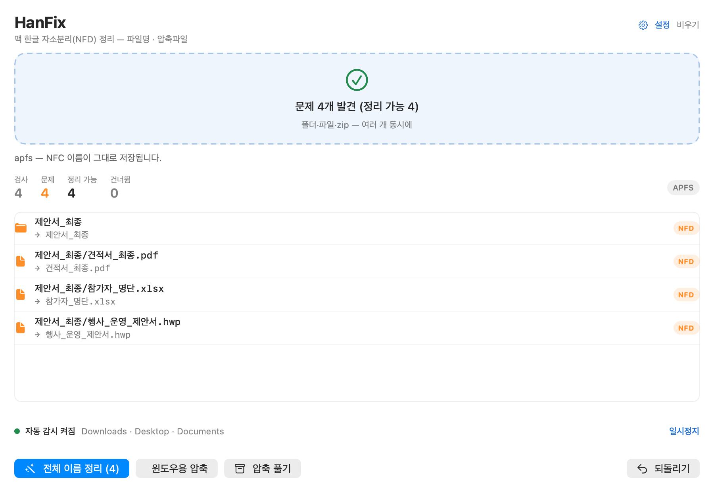
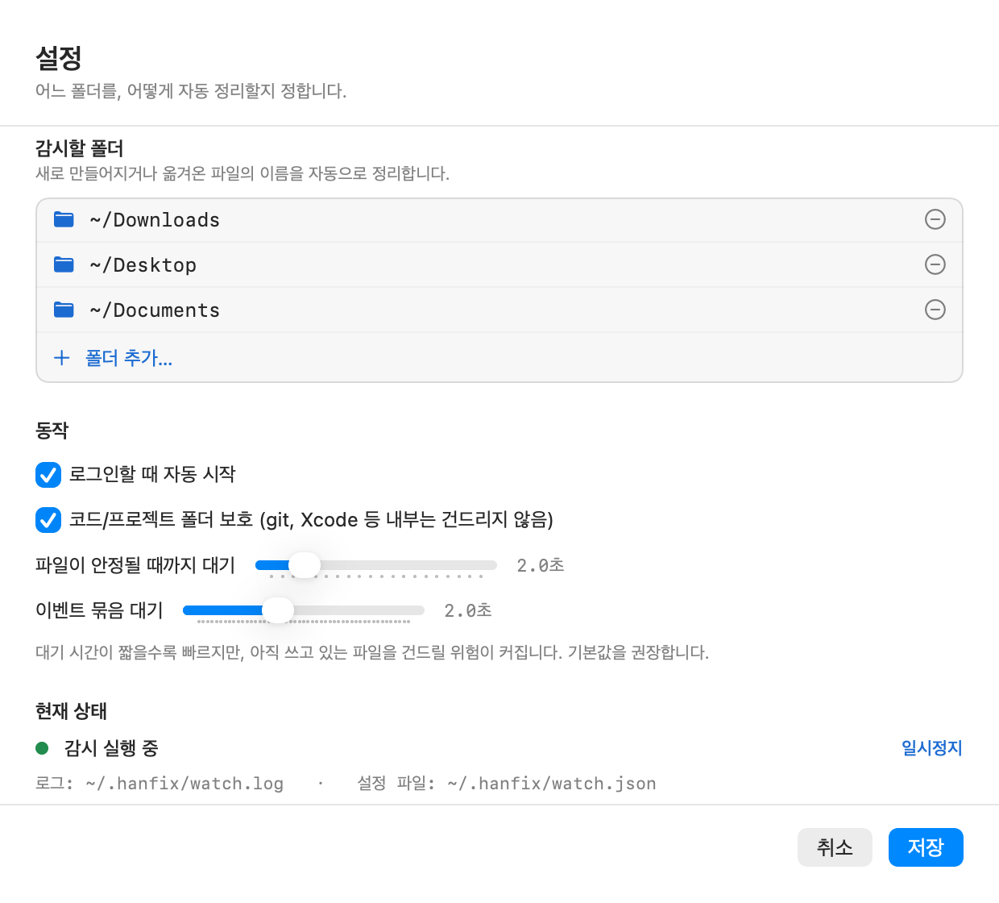

# HanFix — 맥 한글 자소분리 정리

[English](README.md)

맥에서 만든 한글 파일명이 윈도우·NAS·웹에서 `ㅎㅏㄴㄱㅡㄹ`처럼 깨지는 문제를
**파일명**과 **압축파일** 양쪽에서 해결합니다. 파이썬을 따로 설치할 필요가 없습니다.



## 왜 필요한가

한글 이름이 깨지는 지점은 세 곳이고, 대부분의 도구는 그중 하나만 고칩니다.

| 지점 | 실제로 벌어지는 일 |
|---|---|
| **정규화 차이** | 맥은 `한글`을 12개 코드포인트(U+1112 U+1161 U+11AB …)로 저장하고, 윈도우·리눅스·웹은 5개(음절)를 기대합니다. |
| **APFS** | 정규화를 **보존**하면서 **무시**합니다. 쓴 그대로 남고, 두 표기 모두 같은 파일로 열립니다. 그래서 NFC로 이름을 바꾸면 **실제로 고쳐지고** inode도 유지됩니다. |
| **압축** | 맥 기본 압축(`zip`·`ditto`)은 디스크 바이트를 그대로 담고 **UTF-8 플래그(0x800)를 세우지 않습니다.** 윈도우 탐색기는 이를 CP949로 읽어 글자가 깨집니다. |

그래서 파일명과 포장을 함께 다뤄야 하고, 고칠 수 없는 경우(HFS+, NAS)는
고칠 수 있다고 우기지 않고 거부합니다.

## 설치

1. [Releases](../../releases)에서 최신 `HanFix-x.y.z.dmg`를 받습니다.
2. **HanFix.app**을 **Applications** 폴더로 끌어다 놓습니다.
3. 첫 실행만: 앱을 **우클릭 → 열기 → 열기**. (서명이 애드혹이라 Gatekeeper가 한 번 묻습니다)

파이썬·Homebrew 설치 불필요 — 런타임이 앱 안에 들어 있습니다.
macOS 13 이상(Apple Silicon / Intel 모두 지원).

## 사용법

폴더·파일·zip을 창에 끌어다 놓으면 됩니다.

- **전체 이름 정리** — NFD → NFC로 이름 변경 (먼저 목록으로 확인, 되돌리기 가능)
- **윈도우용 압축** — NFC 이름 + UTF-8 플래그로 zip 생성
- **압축 풀기** — CP949/NFD 이름을 복원하면서 해제
- **되돌리기** — 마지막 작업 취소 (inode 검증)

### 자동 감시 (항시 적용)

**설정 (⌘,)** 에서 폴더를 고르면 됩니다. 기본값은 다운로드·데스크탑·문서.
새로 만들어지거나 옮겨온 파일은 몇 초 안에 백그라운드에서 정리되고,
메뉴 막대 아이콘으로 동작 여부를 확인할 수 있습니다.



감시 모드의 안전 규칙:

- **이름만** 바꿉니다. 내용·확장자·수정시각은 그대로
- 다운로드 중 파일(`.crdownload`, `.part`, `.download` …)은 건너뜁니다
- 아직 쓰고 있는 파일은 안정될 때까지 기다립니다 (기본 2초)
- git 저장소·코드 프로젝트(`package.json`, `*.xcodeproj` …) 내부는 보호합니다
- `.app` 꾸러미, 숨김 시스템 폴더는 들어가지 않습니다
- 모든 변경은 저널에 기록 → 자동 정리도 `hanfix undo`로 되돌릴 수 있습니다

## 고칠 수 없는 경우

- **HFS+ 볼륨** — 파일시스템이 저장 시 NFD를 강제합니다. 감지해서 거부합니다.
- **SMB / NAS** — 맥 클라이언트가 전송 시 NFC로 바꿉니다. 서버에 이미 NFD로 올라간
  파일은 목록엔 보이나 열기/삭제가 실패합니다(error -43). **서버 쪽에서** 정리해야 합니다.
- **이미 만들어진 압축 안의 이름** — `hanfix unzip` / `hanfix zip`을 사용하세요.

## CLI

```bash
H="/Applications/HanFix.app/Contents/Resources/hanfix/bin/hanfix"

$H scan  ~/Downloads                  # 보기만 (변경 없음)
$H fix   ~/Downloads                  # 예행연습(기본)
$H fix   ~/Downloads --apply          # 실제 이름 변경
$H undo                               # 마지막 배치 되돌리기
$H zip   ~/Downloads -o out.zip       # 윈도우 안전 zip
$H unzip download.zip                 # 이름 복원하며 해제
$H zipcheck download.zip              # 이 zip이 윈도우에서 안전한가
$H watch --status                     # 감시 상태
$H watch --install ~/Downloads ~/문서  # 감시 폴더 지정
$H watch --pause | --resume | --uninstall
```

모든 명령에 `--json`. 종료 코드: `0` 정상 / `1` 문제 있음 / `2` 고칠 수 없는 볼륨.

## 구조

```
app/            SwiftUI 프런트엔드 (유니버설 바이너리, Xcode 프로젝트 불필요)
hanfix/core.py  정규화·볼륨 판별·안전한 rename·저널·zip
hanfix/watch.py FSEvents 감시 + 정책 (디바운스, 안정화 대기, 프로젝트 보호)
hanfix/cli.py   CLI — 앱이 호출하는 것과 같은 진입점
vendor/         내장 CPython (scripts/fetch_runtime.sh 로 받음, git 제외)
```

감시자는 launchd가 **HanFix.app**을 실행하고, 앱이 파이썬 감시자를 자식으로 띄웁니다.
이 우회는 의도된 것입니다: launchd가 직접 띄우면 개인정보 보호(TCC)가 `~/Downloads`
접근을 막지만, 앱의 자식 프로세스는 앱의 권한을 물려받습니다.
자세한 내용은 [docs/GUIDE.ko.md](docs/GUIDE.ko.md) 참고.

## 소스에서 빌드

```bash
./scripts/fetch_runtime.sh     # 최초 1회: 내장 파이썬 (~105 MB)
./scripts/build.sh             # → build/HanFix.app (유니버설)
./scripts/build_dmg.sh         # → build/HanFix-x.y.z.dmg
python3 tests/test_hanfix.py   # 단위 테스트 13개
python3 tests/test_watch.py    # 감시 통합 테스트 6개
```

Xcode Command Line Tools(`swiftc`)가 필요합니다.

## 개인정보

네트워크 통신, 텔레메트리, 분석 도구가 없습니다. 사용자가 지정한 폴더 안에서만,
로컬로 동작합니다.

## 라이선스

MIT — [LICENSE](LICENSE)
